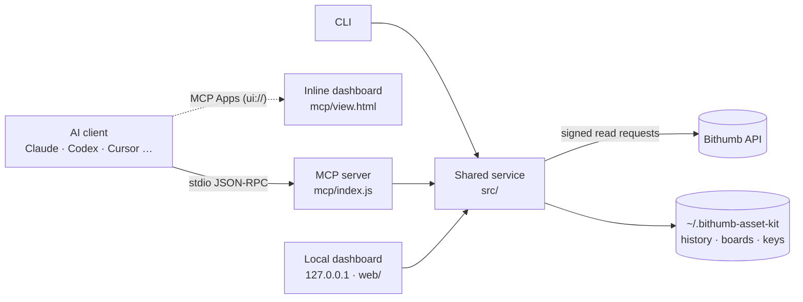

English | [한국어](./README.md)

# Bithumb Asset Toolkit · MCP

**Connect your Bithumb account to AI, read-only, and draw an asset dashboard with one sentence.**


An **MCP server** that brings a Bithumb account's balances, unrealized P&L, allocation, value history, daily asset changes, and order and deposit/withdrawal history to AI clients. The same features are available from a **CLI**, a **local dashboard**, and an AI workflow guide (**Skill**).

- “Show me my asset dashboard” → the dashboard is drawn inside the conversation (in MCP Apps clients).
- “Make a BTC + ETH board and open it” → the layout is saved and you get a local URL with that board selected.
- “What did I deposit in KRW last month?” → the period is read in bounded pages and totalled.

<p align="center">
  
  <br><sub>A dashboard drawn inside the conversation (<code>dashboard_snapshot</code> + MCP Apps). Every number in this README is synthetic demo data.</sub>
</p>

| | |
| --- | --- |
| **Zero dependencies** | Node.js 22.13+ built-ins only. No `npm install`. |
| **Read-only** | No order, cancel, or withdrawal tools. The only writes are local dashboard layouts. |
| **Keys stay local** | Never accepted as tool input, never sent to the browser or the AI. |
| **Exact amounts** | BigInt decimals with no floating-point error; unknown values are `null`, never `0`. |
| **Built for AI** | Small one-call responses for drawing, field selection, continuation cursors, progress and cancellation. |

> An independent single-user prototype. Not an official Bithumb package and not published to npm.

---

## What you can do

### 1. Draw a dashboard inside the conversation

Ask “show me my asset dashboard” and the AI calls `dashboard_snapshot` **once**. One response (about 2.9KB for 30 days on the demo account) carries the summary, top holdings with an exact `others` slice, the value trend as columns, and optionally daily changes.

- In **MCP Apps clients** (for example Claude, ChatGPT, VS Code) the result is drawn inline. You can switch the period (7/30/90 days, 1 year), refresh, hide amounts, and open the local dashboard. It follows the host's light/dark theme and narrow widths.
- Other clients receive the same data as JSON and answer with tables, charts, or summaries.
- Saved boards can be drawn with `boardId`, reusing their asset scope and period.

<p align="center"><br><sub>The view follows the host's dark theme.</sub></p>

### 2. Ask about your assets

| Ask | Tool the AI uses | You get |
| --- | --- | --- |
| “Show my Bithumb balance and P&L” | `portfolio_get_summary` | Total value, unrealized P&L, largest assets, missing-data warnings |
| “Only coins in profit, best return first” | `portfolio_get_holdings` (`performance: gain`, `sort: profit`) | Matching holdings with only the fields needed |
| “What share are BTC and ETH?” | `portfolio_get_allocation` (`symbols`) | Allocation recomputed for that subset |
| “My XRP average price and P&L?” | `portfolio_get_holdings` (`symbol: XRP`) | Quantity, average cost, price, P&L |
| “Balance plus recent KRW deposits” | `portfolio_get_report` (`sections`) | A report that calls only the selected sections |
| “Are any of my coins under an exchange alert?” | `market_get_warnings` | Bithumb alerts (price spikes etc.) and caution designations that affect your holdings |
| “Something seems disconnected” | `system_diagnose` | Mode, key status (no values), key expiry, API connectivity |

### 3. Build your own boards

“Make a long-term BTC + ETH board and open it” → `dashboard_save_board` with `open: true` saves the layout, starts the local dashboard and returns `http://127.0.0.1:4319/?board=<id>` in one call.

- Each board keeps its asset scope, widgets (summary, trend, allocation, holdings, activity) and their order, trend period, and refresh interval.
- Edits send only the changed fields; `revision` prevents lost updates from other windows.
- **A dashboard already open in the browser picks up the change within seconds.** No reload needed.

<p align="center"><br><sub>The local dashboard (<code>npm run demo</code>). Tabs at the top are saved boards.</sub></p>

### 4. Trends and daily asset changes

Recorded portfolio values (at most one point per five minutes, endpoints preserved when sampled) and a KST daily calendar with gaps marked. They include deposits and withdrawals: **not investment returns, never back-filled.**

### 5. Orders and transfers

`account_get_records` returns at most 50 rows / 5 upstream pages per call and continues with `nextCursor`, so long periods stay small and `coverage.complete` says when the chain is done. Filter by asset, state, or side and select fields. Read-only.

### 6. Prices and market context (no key needed)

- `market_get_candles`: 1/3/5/10/15/30-minute, 1/4-hour, daily, weekly and monthly candles. Closes by default, `ohlc: true` adds open/high/low/volume, `to` pages further back.
- `market_get_tickers`: price, change and 24h traded value for your holdings or every KRW market, sorted, with `held` flags (“top 10 gainers today”).
- `market_get_warnings`: Bithumb's alert system (price spikes, volume spikes, global price gaps; caution/warning/danger) and caution-designated markets. Held assets under a caution designation also get a warning and a badge in the views.

### 7. Terminal and custom screens

```bash
node cli/asset-kit.js portfolio --demo
node cli/asset-kit.js history --days 30 --daily --demo
```

The dashboard is plain HTML/CSS/JS with no build step: edit `web/`, or let the AI fetch only the files it needs with `dashboard_get_template` and serve a folder with `asset-kit dashboard --web-dir <folder>`. [`examples/sample-dashboard.html`](./examples/sample-dashboard.html) opens without a server.

---

## Quick start

```bash
git clone https://github.com/realmi-lab/asset_kit.git
cd asset_kit
npm run demo   # synthetic data at http://127.0.0.1:4319, no install needed
```

## Connect an AI client

```json
{
  "mcpServers": {
    "bithumb-assets": { "command": "node", "args": ["/absolute/path/to/asset_kit/mcp/index.js"] }
  }
}
```

Append `"--demo"` to `args` for synthetic data. Codex: `command = "node"`, `args = ["/absolute/path/to/asset_kit/mcp/index.js"]` under `[mcp_servers.bithumb_assets]`. The full guide (Korean) in [mcp/README.md](./mcp/README.md) covers every client, `--modules`/`--read-only`/`--verbose`, and the dashboard workflow.

## Keys

Create a **read-only** API key with an allowed IP at [Bithumb API management](https://www.bithumb.com/react/api-support/management-api), then run `node cli/asset-kit.js config init` (hidden input, saved with 0600 permissions) and `node cli/asset-kit.js doctor`. `BITHUMB_ACCESS_KEY`/`BITHUMB_SECRET_KEY` environment variables take precedence. **Never paste keys into AI chat.** Account data you query through MCP may be processed by the connected AI service.

## 17 MCP tools

| Module | Tools |
| --- | --- |
| **Dashboard** | `dashboard_snapshot` (one compact, chart-ready call; drawn inline in MCP Apps clients), `dashboard_list_boards`, `dashboard_save_board` (`open: true` saves and opens), `dashboard_open` (`boardId` selects a board), `dashboard_get_template` |
| **Portfolio** | `portfolio_get_summary`, `portfolio_get_holdings` (search, gain/loss filters, sorting, fields, paging), `portfolio_get_allocation`, `portfolio_get_history` (`maxPoints`, `daily: true`), `portfolio_get_report` (`sections`) |
| **Market** | `market_get_candles` (minute to month intervals, optional OHLC), `market_get_tickers` (holdings or all KRW markets), `market_get_warnings` (alerts and caution markets) |
| **Account** | `account_get_records` (bounded pages and continuation, ≤366 days), `account_get_orders`, `account_get_transfers` |
| **System** | `system_diagnose` (includes API key expiry, warning within 14 days) |

Every tool publishes a `title` and an `outputSchema`; errors carry `retryable` and a `recovery` hint, and Bithumb's named causes (`invalid_query_payload`, `expired_jwt`, `NotAllowIP`, `out_of_scope`, …) become specific guidance with an `upstream` code. The whole `tools/list` stays under 28KB. Progress uses `_meta.progressToken` and `notifications/progress`; cancellation uses `notifications/cancelled`.

**`account_get_records` migration (0.4.0):** at most 50 rows and 5 upstream pages per call. Continue with the same `kind` and `pagination.nextCursor` as `cursor`, even if `rows` is empty. Filters stay fixed; fields may be selected on each call. Totals cover only that response's rows; `coverage.complete` describes the entire cursor chain. Tokens are process-local, expire 10 minutes after the query starts, and have a 32-token storage bound. Each chain permits at most 1,000 upstream pages/10,000 matching IDs; narrow the query on `QUERY_LIMIT`. HTTP/CLI collection behavior is unchanged.

## Local dashboard

```bash
npm run demo     # synthetic data at http://127.0.0.1:4319
npm start        # live account
```

- Board tabs keep widgets, asset scope, periods (7/30/90 days, 1 year), and refresh settings. `?board=<id>` opens a board directly; boards changed through MCP or another window appear within seconds.
- Explore chart values with the pointer, touch slider, or arrow keys. The daily calendar marks changes across missing recording days.
- Search holdings, filter gains/losses/unknown P&L, sort in either direction, and export exactly what is visible. Filters persist per board.
- Orders/transfers with 7-day, 30-day, or current-month presets, date validation, cancellation, filters, and CSV export with coverage metadata.
- Hide amounts (CSV exports are disabled; public prices stay visible), pause/resume refresh, and keep the last snapshot after a failed refresh.

## How it works



## Scope and security

- Quantities include locked balances; amounts use exact BigInt decimals returned as decimal strings; unknown values are `null`.
- Unrealized P&L uses the API average cost of current holdings and excludes fees and realized P&L. Coins without a KRW market are valued through BTC × KRW-BTC.
- Recorded history includes deposits/withdrawals and is never back-filled. No all-time realized P&L, tax, staking, or lending products.
- The dashboard binds to `127.0.0.1` and checks Host/Origin; layout writes need a same-origin JSON request with a custom header. Data lives in `~/.bithumb-asset-kit` (0700/0600), configurable with `ASSET_KIT_DATA_DIR`. The inline view uses no network or external files.

## Changelog

- **0.5.0** — `dashboard_snapshot`; the MCP Apps view `ui://bithumb-asset-kit/dashboard.html`; `open: true`, `boardId`, `?board=<id>` and live board sync. On the demo account a dashboard is about 2.9KB (UTF-8) for 30 days and 4.1KB for a year, versus four calls (about 7.2KB) or a 32KB year of history before. After comparing with the OKX and Binance MCP servers: interval candles with OHLC, `market_get_tickers`, `market_get_warnings`, tool titles with a size budget, and API key expiry in diagnostics (no trading features). Closed orders are read 1,000 per upstream page. Fixes from an adversarial review: exact snapshot endpoints beyond 400 records, unknown `others` as `null`, no duplicate board when the dashboard fails to start, read-only view without a dead button, URL shown when a host refuses a link, and board sync no longer cancelling recovery reloads, overriding the first board, or interrupting a history query on rename.
- **0.4.0** — holdings search/filters/sorting/fields, `force`, report `sections`, history `maxPoints`, output schemas, actionable errors, bounded records with cursors, progress and cancellation.

## Development and verification

```bash
npm test         # dependency-free regression tests
npm run sample   # rebuild the synthetic sample page
```

Bithumb API usage was checked against the [official docs](https://apidocs.bithumb.com): paths, parameters and response fields of all 15 endpoints used, JWT (HS256 with `access_key`/`nonce`/`timestamp`, SHA-512 `query_hash` when there are parameters), `next_key`/`page` paging, and rate limits (about 25 requests/s sent versus 140–150/s allowed per category). Verified with the official MCP SDK client 1.32.2 over real stdio: all 17 output schemas, the MCP Apps view resource, progress, cancellation and cursor replay (`npm run verify:mcp-sdk` with `MCP_SDK_ROOT` pointing to an external SDK install). The inline view was checked in a test host that follows the MCP Apps protocol. **Display inside a real MCP Apps client and live account access with real API keys have not been verified yet.**

## License

[MIT](./LICENSE)
