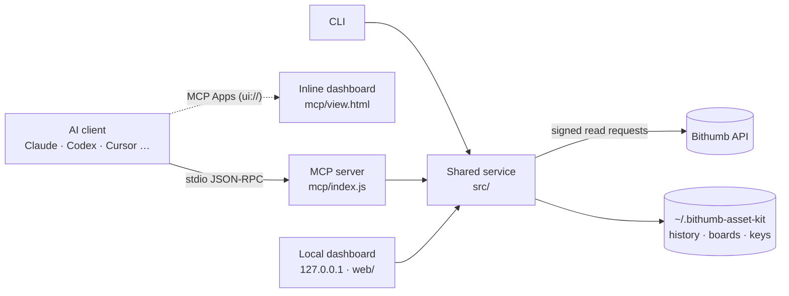

English | [한국어](./README.md)

# Bithumb Asset Toolkit · MCP

**Connect your Bithumb account to AI in read-only mode and get an asset dashboard from a single prompt.**


An **MCP server** that brings a Bithumb account's balances, unrealized P&L, allocation, value history, daily asset changes, and order and deposit/withdrawal history to AI clients. The same features are available from a **CLI**, a **local dashboard**, and an AI workflow guide (**Skill**, [`skills/bithumb-asset-dashboard`](./skills/bithumb-asset-dashboard/SKILL.md), installed with `node cli/asset-kit.js skill install --path <project>`).

- “Show me my asset dashboard” → the dashboard is drawn inside the conversation (in MCP Apps clients).
- “Make a BTC + ETH board and open it” → the layout is saved and you get a local URL with that board selected.
- “What did I deposit in KRW last month?” → the period is read in bounded pages and totaled.

<p align="center">
  
  <br><sub>A dashboard drawn inside the conversation (<code>dashboard_snapshot</code> + MCP Apps). Every number in this README is synthetic demo data.</sub>
</p>

| | |
| --- | --- |
| **Zero dependencies** | Node.js 22.13+ built-ins only. No `npm install`. |
| **Read-only** | No order, cancel, or withdrawal tools. The only writes are local: dashboard layouts and the recorded value history. |
| **Keys stay local** | Never accepted as tool input, never sent to the browser or the AI. |
| **Exact amounts** | BigInt decimals with no floating-point error; unknown values are `null`, never `0`. |
| **Built for AI** | Compact responses that draw a dashboard in one call, field selection, continuation cursors, progress and cancellation. |

> An independent single-user prototype. Not an official Bithumb package and not published to npm.

---

## What you can do

### 1. Draw a dashboard inside the conversation

Ask “show me my asset dashboard” and the AI calls `dashboard_snapshot` **once**. One response (about 2.9KB for 30 days on the demo account) carries the summary, top holdings with an exact `others` slice, the value trend as column arrays, and optionally daily changes.

- In **MCP Apps clients** (for example Claude, ChatGPT, VS Code) the result is drawn inline. You can switch the period (7/30/90 days, 1 year), refresh, hide amounts, and open the local dashboard. It follows the host's light/dark theme and adapts to narrow widths.
- In other clients, the AI receives the same data as JSON and answers with tables, charts, or summaries.
- Saved boards can be drawn with `boardId`, reusing their asset scope and period.

<p align="center"><br><sub>The view follows the host's dark theme.</sub></p>

### 2. Ask about your assets

| Ask | Tool the AI uses | You get |
| --- | --- | --- |
| “Show my Bithumb balance and P&L” | `portfolio_get_summary` | Total value, unrealized P&L, largest assets, missing-data warnings |
| “Only coins in profit, best return first” | `portfolio_get_holdings` (`performance: gain`, `sort: profit`) | Matching holdings with only the fields needed |
| “What's the split between BTC and ETH?” | `portfolio_get_allocation` (`symbols`) | Allocation recomputed for that subset |
| “My XRP average price and P&L?” | `portfolio_get_holdings` (`symbol: XRP`) | Quantity, average cost, price, P&L |
| “Balance plus recent KRW deposits” | `portfolio_get_report` (`sections`) | A report that fetches only the selected sections |
| “Are any of my coins under an exchange alert?” | `market_get_warnings` | Bithumb alerts (price spikes etc.) and caution designations that affect your holdings |
| “It doesn't seem to be connecting” | `system_diagnose` | Mode, key status (no values), key expiry, API connectivity |

### 3. Build your own boards

“Make a long-term BTC + ETH board and open it” → `dashboard_save_board` with `open: true` saves the layout, starts the local dashboard and returns `http://127.0.0.1:4319/?board=<id>` in one call.

- Each board keeps its asset scope, widgets (ten kinds: summary, trend, insights, allocation, heatmap, performance, holdings, market, warnings, activity) and their order, trend period, and refresh interval.
- Edits send only the changed fields; `revision` prevents lost updates from other windows.
- **A dashboard already open in the browser picks up the change within seconds.** No reload needed.

<p align="center"><br><sub>The local dashboard (<code>npm run demo</code>). The side menu switches pages; tabs at the top are saved boards.</sub></p>

### 4. Trends and daily asset changes

Portfolio values recorded on this computer each time you query (at most one point per five minutes; first and last points kept when downsampled) and a daily calendar in Korea Standard Time (KST) with gaps marked. They include deposits and withdrawals: **not investment returns, never backfilled.**

### 5. Orders and transfers

`account_get_records` returns by default at most 50 rows / 5 upstream pages per call and continues with `nextCursor`, so responses stay small even for long periods, and `coverage.complete` says when the whole cursor chain is done. Filter by asset, state, or side and select fields. Read-only.

### 6. Prices and market context (mostly keyless)

- `market_get_candles`: 1/3/5/10/15/30-minute, 1/4-hour, daily, weekly and monthly candles. Returns closing prices by default; `ohlc: true` adds open/high/low/volume, and `to` pages further back.
- `market_get_tickers`: price, change and 24h traded value for your holdings or every KRW market, sorted, with `held` flags (“top 10 gainers today”).
- `market_get_warnings`: Bithumb's alert system (price spikes, volume spikes, global price gaps; caution/warning/danger) and caution-designated markets. Held assets under a caution designation also get a warning and a badge in the views.
- These use public prices and work without a key, except `scope: holdings` (the default for `market_get_tickers` and `market_get_warnings`), which needs one.

### 7. Terminal and custom screens

```bash
node cli/asset-kit.js portfolio --demo
node cli/asset-kit.js history --days 30 --daily --demo
```

The dashboard is plain HTML/CSS/JS with no build step: edit `web/`, or let the AI fetch only the files it needs with `dashboard_get_template`, save its edited copy in a new folder, and serve it with `node cli/asset-kit.js dashboard --web-dir <folder>`. [`examples/sample-dashboard.html`](./examples/sample-dashboard.html) opens without a server.

### 8. Live prices, charts, actual returns and calculators (local dashboard)

- **Live prices and alerts**: prices of held and watched coins update from Bithumb's public WebSocket, and the total and P&L are revalued with them. Alerts such as “BTC at or above ₩110M”, “my return at or above 20%” or “total value at or below ₩30M” are stored in your browser.
- **Coin charts**: 15-minute, 1-hour, 4-hour, daily and weekly candles with 5/20/60 moving averages, volume and your average-cost line, for any KRW market.
- **Actual returns**: profit over the last 3, 6 or 12 months with deposits and withdrawals taken out, a monthly report, and realized P&L on sales (average-cost estimate).
- **Calculators**: average cost after buying more, target-weight rebalancing (amounts to buy or sell) and price scenarios. Calculations only; no orders are placed.

---

## Quick start

```bash
git clone https://github.com/realmi-lab/asset_kit.git
cd asset_kit
npm run demo   # synthetic data at http://127.0.0.1:4319, no install needed
```

## Connect an AI client

Register the server in your MCP client, replacing the path with the absolute path of your clone. For Claude Code, put this in `.mcp.json` at the project root or in `~/.claude.json`, or run `claude mcp add bithumb-assets -- node /absolute/path/to/asset_kit/mcp/index.js`.

```json
{
  "mcpServers": {
    "bithumb-assets": { "command": "node", "args": ["/absolute/path/to/asset_kit/mcp/index.js"] }
  }
}
```

Append `"--demo"` to `args` for synthetic data. Codex: `command = "node"`, `args = ["/absolute/path/to/asset_kit/mcp/index.js"]` under `[mcp_servers.bithumb-assets]`. The full guide (Korean) in [mcp/README.md](./mcp/README.md) covers Codex, Cursor, VS Code, Windsurf and Claude Desktop, `--modules`/`--read-only`/`--verbose`, and the dashboard workflow.

## Keys

Create a **read-only** API key with an allowed IP at [Bithumb API management](https://www.bithumb.com/react/api-support/management-api), then run `node cli/asset-kit.js config init` (hidden input, saved only to `~/.bithumb-asset-kit/credentials.json` with 0600 permissions) and `node cli/asset-kit.js doctor`. `BITHUMB_ACCESS_KEY`/`BITHUMB_SECRET_KEY` environment variables take precedence; load a `.env` file with `--env-file .env`. **Never paste keys into AI chat.** Account data you query through MCP may be processed by the connected AI service.

## 17 MCP tools

| Module | Tools |
| --- | --- |
| **Dashboard** | `dashboard_snapshot` (one compact, chart-ready call; drawn inline in MCP Apps clients), `dashboard_list_boards`, `dashboard_save_board` (`open: true` saves and opens), `dashboard_open` (`boardId` selects a board), `dashboard_get_template` |
| **Portfolio** | `portfolio_get_summary`, `portfolio_get_holdings` (search, gain/loss filters, sorting, fields, paging), `portfolio_get_allocation`, `portfolio_get_history` (`maxPoints`, `daily: true`), `portfolio_get_report` (`sections`) |
| **Market** | `market_get_candles` (minute to month intervals, optional OHLC), `market_get_tickers` (holdings or all KRW markets), `market_get_warnings` (alerts and caution-designated markets) |
| **Account** | `account_get_records` (bounded pages and continuation, ≤366 days), `account_get_orders`, `account_get_transfers` |
| **System** | `system_diagnose` (includes API key expiry, warning within 14 days) |

Every tool publishes a `title` and an `outputSchema`; errors carry `retryable` and a `recovery` hint, and Bithumb's named causes (`invalid_query_payload`, `expired_jwt`, `NotAllowIP`, `out_of_scope`, …) become specific guidance with an `upstream` code. The whole `tools/list` stays under 28KB. Progress uses `_meta.progressToken` and `notifications/progress`; cancellation uses `notifications/cancelled`.

**`account_get_records` migration (0.4.0):** by default at most 50 rows and 5 upstream pages per call (`pageSize` up to 200, `scanPages` up to 20). Continue with the same `kind` and `pagination.nextCursor` as `cursor`, even if `rows` is empty. Filters stay fixed; fields may be selected on each call. Totals cover only that response's rows; `coverage.complete` describes the entire cursor chain. Cursors are process-local and expire 10 minutes after the first query; at most 32 are kept, oldest evicted first. Each chain permits at most 1,000 upstream pages/10,000 matching IDs; if you get `QUERY_LIMIT`, narrow the date range or asset scope. HTTP/CLI collection behavior is unchanged.

## Local dashboard

```bash
npm run demo     # synthetic data at http://127.0.0.1:4319
npm start        # live account
```

- Eight pages in a side menu (four bottom tabs plus a “More” sheet on phones): Dashboard (saved boards), Assets (heatmap, allocation, holdings), P&L (insights, P&L per asset, value trend), Returns (actual profit, monthly report, realized P&L), Chart (coin candles), Market (live watchlist, price rankings and Bithumb alerts), Calculators and History. `?page=chart` opens a page directly.
- The total card shows the total value and the change over the selected period; hovering over the chart or using the arrow keys turns the total into the value at that point. Today's price move, unrealized P&L and crypto/cash shares sit underneath.
- Live prices: the server subscribes to Bithumb's public WebSocket (no key) for held and watched coins and forwards the latest prices to the page (batched once a second) over same-origin Server-Sent Events (`/api/stream`). Changed prices flash red (up) or blue (down) and the total, P&L and allocation are revalued with live prices (balances are re-read every 30 seconds). If the WebSocket keeps failing, REST prices are polled every 3 seconds; the top bar shows the connection state.
- Price alerts on price above/below, daily rise/fall, your return or loss, and total value, stored in your browser. While the page is open they are checked against live values, fire once when met and re-arm when the condition clears. An alert whose value cannot be read (an asset not on the current board, a reload in progress) neither fires nor re-arms, and total value is only checked against the whole account. With alerts on, the live connection stays open while the tab is hidden, so if you allow browser notifications, alerts reach you while you use other tabs, as long as this tab stays open.
- A watchlist that can include coins you do not hold, with live prices, 30-day price lines and one-click chart or alert. Stored only in your browser.
- Coin chart: 15-minute to weekly candles, 5/20/60 moving averages, volume, your average-cost line and a live last candle. Hover over a candle or use the arrow keys to read open/high/low/close; period return, high, low and your quantity, P&L and distance to break-even sit below.
- Actual returns over the last 3, 6 or 12 months: change in value minus net deposits (coin transfers valued at that day's close) and a flow-weighted rate (Modified Dietz), drawn as start → net deposits → profit → now, plus monthly bars, a monthly table and realized P&L per coin (average-cost estimate, net of sell fees and of buy fees for coins bought in the window). Not for tax purposes.
- Calculators: averaging down or up (new average cost, quantity for a target average), target-weight rebalancing (current, equal or 10%-cash presets, extra cash, amounts and quantities to trade) and price scenarios for all coins or a single coin. Uses current prices only; no orders are placed.
- Ten widgets: summary, trend (with a daily-change calendar), insights, allocation, heatmap (area = value, color = daily change or return), performance (P&L bars per asset), holdings (30-day price lines), market (by traded value, gainers, losers, holdings), warnings (Bithumb alerts and caution flags), activity.
- Board tabs keep widgets, asset scope, periods (7/30/90 days, 1 year), and refresh settings. `?board=<id>` opens a board directly; boards changed through MCP or another window appear within seconds.
- Light and dark themes follow the OS; the toggle is remembered in the browser. The daily calendar shades larger changes darker and marks changes that span unrecorded days with `*` and the gap length.
- Search holdings, filter gains/losses/unknown P&L, sort in either direction, and export exactly what is visible. Filters persist per board.
- Orders/transfers with 7-day, 30-day, or current-month presets, date validation, stopping a running query, filters, and CSV export with coverage metadata.
- Hide amounts (CSV exports are disabled; public prices stay visible), pause/resume refresh, and keep the last snapshot after a failed refresh.

## How it works



## Scope and security

- Quantities include locked balances; amounts use exact BigInt decimals returned as decimal strings; unknown values are `null`.
- Unrealized P&L uses the API average cost of current holdings and excludes fees and realized P&L. Coins without a KRW market are valued at their BTC-market price × the KRW-BTC price.
- History is recorded on this computer each time you query (at most once every five minutes); it includes deposits/withdrawals and is never backfilled.
- Actual profit on the Returns page is end value − start value − net deposits. Coin transfers use that day's close; pending or cancelled transfers are excluded. Start and month-end values come from recorded history within seven days before the boundary plus the transfers up to it; months without such a record stay empty. Realized P&L recomputes sales in the window with average cost and is an estimate. Coins bought in the window carry their buy fee in the cost; coins bought earlier use the exchange's average cost, which leaves out fees. BTC-market orders have no KRW amount and are left out.
- No tax reports, realized P&L beyond 12 months, staking, or lending products.
- Live prices come from the server's keyless connection to Bithumb's public WebSocket; the page only talks to its own `/api/stream`, so the CSP keeps `connect-src 'self'`. The watchlist, alerts and target weights stay in browser storage and are never sent to the server or the AI.
- The dashboard binds to `127.0.0.1` and checks Host/Origin; layout writes need a same-origin JSON request with a custom header. Data lives in `~/.bithumb-asset-kit` (directory 0700, files 0600), configurable with `ASSET_KIT_DATA_DIR`. The inline view uses no network or external files.

## Changelog

- **0.7.0** — Live prices: the server subscribes to Bithumb's public WebSocket (`wss://ws-api.bithumb.com/websocket/v1`, no key) and streams to the page over same-origin SSE (`/api/stream`); holdings are revalued with live prices in exact decimals (nothing is recorded to history), and the feed falls back to 3-second REST polling; status changes reach the page at once and a stream the server refused is reopened after a pause. Price alerts (price, daily change, your return, total value; optional browser notifications) and a watchlist, both stored in the browser. New Chart page (15-minute to weekly candles, MA 5/20/60, volume, average-cost line, live last candle, crosshair and keyboard), Returns page (actual profit and Modified Dietz rate over 3/6/12 months, value bridge, monthly report, average-cost realized P&L; transfers between the last record and a month boundary are carried to the boundary so they never read as profit) and Calculators page (averaging, rebalancing, scenarios; no orders). Eight grouped menu pages with four bottom tabs and a “More” sheet on phones, where the watchlist, monthly and rebalancing tables keep only key columns. New local endpoints `/api/markets`, `/api/market?interval=&count=`, `/api/returns?months=`, `/api/tickers?symbols=` and `/api/stream`, also described by `dashboard_get_template`. The sample page simulates live prices and carries chart and returns data (synthetic).
- **0.6.0** — Redesigned local dashboard: total, period change and chart in one card, chart scrubbing that updates the total, light/dark themes, 30-day price lines per holding and card rows on phones. A five-page side menu (Dashboard, Assets, P&L, Market, History) and ten widgets: new insights, heatmap, performance, market and warnings widgets, selectable in the editor and through `dashboard_save_board` (new boards include insights by default). The summary gains today's price move (`dayChangeKrw`, `dayChangePct`, `dayChangeComplete`: the difference between current value and current quantities valued at the previous close), also in `dashboard_snapshot`. New read-only dashboard endpoints `/api/tickers` and `/api/warnings` (public Bithumb prices). The inline MCP Apps view shares the new design. Allocation colors drop red and blue (they mean up and down in Korean markets); the remaining five pass color-vision-deficiency checks. Demo coins now have distinct price paths that agree with their daily change and the demo value history.
- **0.5.0** — `dashboard_snapshot`; the MCP Apps view `ui://bithumb-asset-kit/dashboard.html`; `open: true`, `boardId`, `?board=<id>` and live board sync. On the demo account a dashboard is about 2.9KB (UTF-8) for 30 days and 4.1KB for a year, versus four calls (about 7.2KB) or 32KB for a year of history previously. Added after comparing with the OKX and Binance MCP servers: interval candles with OHLC, `market_get_tickers`, `market_get_warnings`, tool titles with a size budget, and API key expiry in diagnostics (no trading features). Closed orders are read 1,000 per upstream page. Fixes from an adversarial review: exact first/last snapshot values and omitted counts beyond 400 records, unknown `others` as `null`, no duplicate board when the dashboard fails to start, read-only view without a dead button, URL shown when a host refuses a link, and board sync no longer cancelling recovery reloads, overriding the first board, or interrupting a history query on rename. A dashboard that cannot start now says why (port in use, permission denied by a sandbox or security software, …) instead of a generic error, in MCP, the inline view and the CLI.
- **0.4.0** — Holdings search/filters/sorting/fields, `force`, report `sections`, history `maxPoints`, output schemas, actionable errors, bounded records with cursors, progress and cancellation.

## Development and verification

```bash
npm test         # dependency-free regression tests
npm run sample   # rebuild the synthetic sample page
```

Bithumb API usage was checked against the [official docs](https://apidocs.bithumb.com): paths, parameters and response fields of all 15 endpoints used (minute candles counted as one), JWT (HS256 with `access_key`/`nonce`/`timestamp`, SHA-512 `query_hash` when there are parameters), `next_key`/`page` paging, and rate limits (about 25 requests/s sent versus 140–150/s allowed per category). The public WebSocket was checked against the docs and a live connection: `ticker` subscriptions in `DEFAULT` format, binary UTF-8 JSON frames, a snapshot before real-time messages, `PING` answered with `{"status":"UP"}`, and a disconnect after about 120 idle seconds (a PING goes out every 50 seconds). Verified with the official MCP SDK client 1.32.2 over real stdio: all 17 output schemas, the MCP Apps view resource, progress, cancellation and cursor replay (`npm run verify:mcp-sdk` with `MCP_SDK_ROOT` pointing to an external SDK install). The inline view was checked in a test host that follows the MCP Apps protocol. **Display inside a real MCP Apps client and live account access with real API keys have not been verified yet.**

## License

[MIT](./LICENSE)
