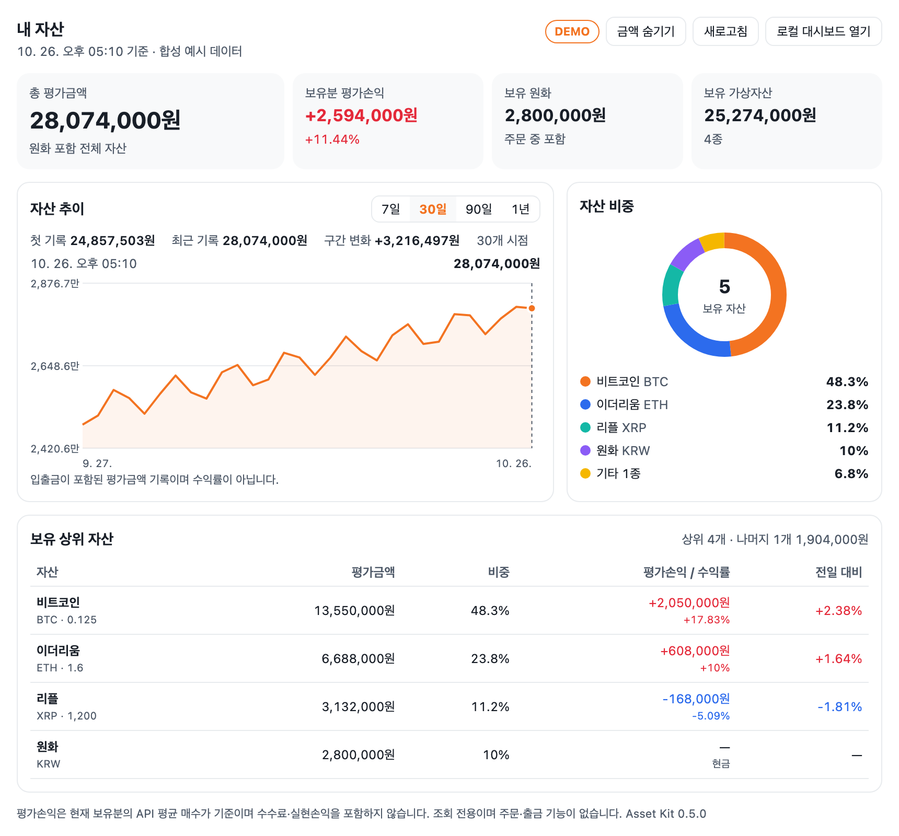
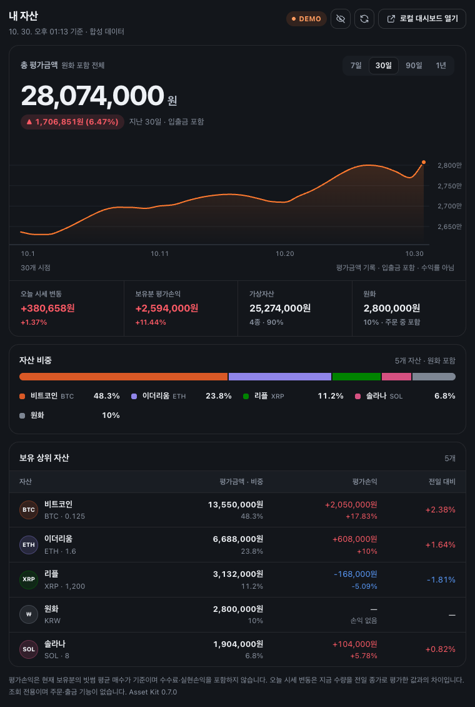
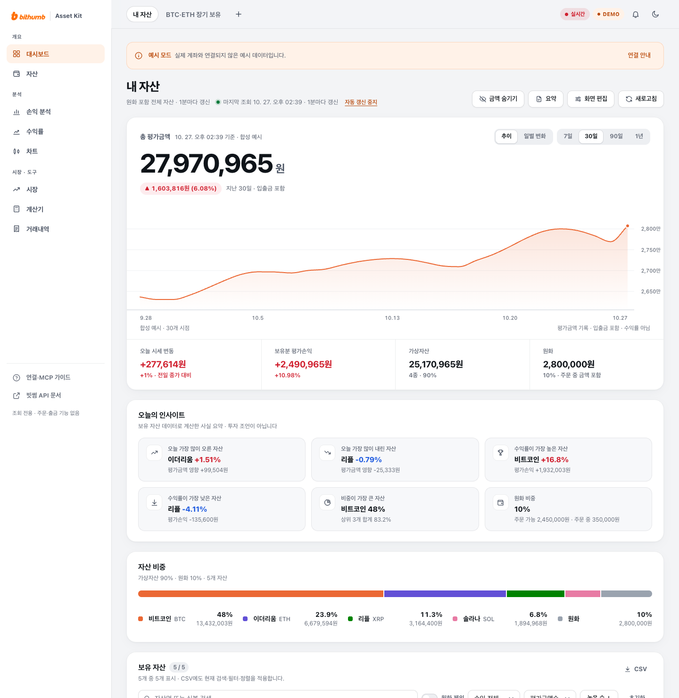
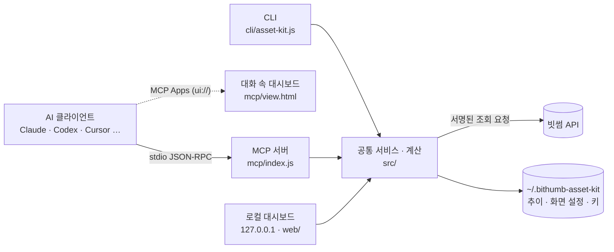

[English](./README.en.md) | 한국어

# 빗썸 자산 툴킷 · MCP

**내 빗썸 계좌를 AI에 조회 전용으로 연결하고, 말 한마디로 자산 대시보드를 그립니다.**


빗썸 계좌의 잔고, 평가손익, 자산 비중, 평가금액 추이, 일별 자산 변화, 주문·입출금 내역을 AI 클라이언트에 연결하는 **MCP 서버**입니다. 같은 기능을 **CLI**, **로컬 대시보드**, AI 작업 가이드(**Skill**)로도 씁니다.

- “내 자산 대시보드 보여줘” → 대화 안에 대시보드가 그려집니다(MCP Apps 지원 클라이언트).
- “BTC·ETH만 묶은 화면 만들어서 열어줘” → 화면 설정을 저장하고, 그 화면이 선택된 로컬 대시보드 주소를 돌려줍니다.
- “지난달 원화 입금 합계 알려줘” → 기간 내역을 나눠 읽고 합계를 정리합니다.

<p align="center">
  
  <br><sub>대화 안에 그려진 대시보드(<code>dashboard_snapshot</code> + MCP Apps). 이 README의 모든 숫자는 데모 모드의 합성 데이터입니다.</sub>
</p>

| | |
| --- | --- |
| **외부 의존성 0개** | Node.js 22.13 이상의 내장 기능만 씁니다. `npm install`이 필요 없습니다. |
| **조회 전용** | 주문·취소·출금 도구가 없습니다. 쓰기는 이 컴퓨터의 대시보드 화면 설정뿐입니다. |
| **키는 이 컴퓨터에만** | 키를 도구 입력으로 받지 않고, 브라우저나 AI로 보내지 않습니다. |
| **정확한 금액** | BigInt 십진 계산으로 부동소수점 오차가 없고, 모르는 값은 `0`이 아니라 `null`입니다. |
| **AI에 맞춘 응답** | 한 번 호출로 그릴 수 있는 작은 응답, 필드 선택, 이어받기, 진행 알림·취소를 지원합니다. |

> 단일 사용자 로컬 조회용 개발 시제품입니다. 빗썸 공식 패키지와 별개이며 npm에는 배포하지 않았습니다.

---

## 목차

- [이런 걸 할 수 있어요](#이런-걸-할-수-있어요)
- [30초 체험](#30초-체험)
- [AI 클라이언트에 연결](#ai-클라이언트에-연결)
- [계좌 연결](#계좌-연결)
- [MCP 도구 17개](#mcp-도구-17개)
- [로컬 대시보드](#로컬-대시보드)
- [CLI](#cli) · [Skill](#skill)
- [동작 방식](#동작-방식)
- [계산 기준과 범위](#계산-기준과-범위) · [보안](#보안) · [조회 최적화](#조회-최적화)
- [변경 내역](#변경-내역) · [개발과 검증](#개발과-검증)

---

## 이런 걸 할 수 있어요

### 1. 대화 안에서 대시보드 그리기

“내 자산 대시보드 보여줘”라고 하면 AI가 `dashboard_snapshot`을 **한 번** 호출합니다. 요약, 비중 상위 자산, 추이, 보유 상위 자산이 한 응답(데모 30일 기준 약 2.9KB)에 들어 있습니다.

- **MCP Apps를 지원하는 클라이언트**(예: Claude, ChatGPT, VS Code)에서는 결과가 대화 안에 대시보드 화면으로 그려집니다. 화면에서 기간(7·30·90일·1년)을 바꾸고, 새로고침하고, 금액을 숨기고, 로컬 대시보드를 바로 열 수 있습니다. 라이트·다크 테마와 모바일 폭에 맞춰 그려집니다.
- 지원하지 않는 클라이언트에서는 같은 데이터를 JSON으로 받아 AI가 표·차트·요약으로 답합니다.
- 저장한 화면이 있으면 “장기 보유 화면 보여줘”처럼 말해 `boardId`로 그 화면의 자산 범위와 기간을 그대로 그립니다.

<p align="center"><br><sub>호스트가 다크 테마면 화면도 다크로 그려집니다.</sub></p>

### 2. 자산을 말로 묻기

| 이렇게 물으면 | AI가 쓰는 도구 | 받는 것 |
| --- | --- | --- |
| “내 빗썸 잔고와 평가손익 보여줘” | `portfolio_get_summary` | 총 평가금액, 보유분 평가손익, 비중 상위 자산, 누락 데이터 경고 |
| “수익 난 코인만 수익률 높은 순으로” | `portfolio_get_holdings` (`performance: gain`, `sort: profit`) | 조건에 맞는 자산과 필요한 필드만 |
| “BTC·ETH 비중이 각각 얼마야?” | `portfolio_get_allocation` (`symbols`) | 고른 자산끼리 다시 계산한 비중 |
| “리플 평균 매수가랑 지금 손익은?” | `portfolio_get_holdings` (`symbol: XRP`) | 수량·평균 매수가·현재가·평가손익 |
| “잔고랑 최근 원화 입금만 같이 정리해줘” | `portfolio_get_report` (`sections`) | 고른 섹션만 조회한 종합 보고서 |
| “내 코인 중에 경보 걸린 거 있어?” | `market_get_warnings` | 빗썸 경보제(가격 급등락 등)·거래 유의 지정 중 보유 자산에 해당하는 것 |
| “연결이 안 되는 것 같아” | `system_diagnose` | 모드, 키 설정 여부(값 제외), 키 만료일, API 연결 상태 |

모든 금액은 통화 단위가 붙은 십진 문자열로 오고, 가격을 모르는 자산은 합계에서 빼고 경고로 알려 줍니다. AI가 빠진 가격이나 수익률을 추정하지 않도록 서버 안내문(`instructions`)에 적어 두었습니다.

### 3. 나만의 대시보드 화면 만들기

“BTC·ETH만 묶은 장기 보유 화면 만들어서 열어줘”라고 하면 AI가 `dashboard_save_board`를 `open: true`로 호출합니다. 화면 설정을 저장하고, 로컬 대시보드를 띄우고, **그 화면이 선택된 주소**(`http://127.0.0.1:4319/?board=<id>`)를 한 번에 돌려줍니다.

- 화면마다 자산 범위, 위젯(요약·추이·비중·보유 내역·거래·입출금)과 순서, 추이 기간, 자동 갱신 간격을 저장합니다.
- “그 화면 기간을 1년으로 바꾸고 거래 내역도 넣어줘”처럼 고치면, 바꾼 값만 보내고 나머지는 유지합니다. 다른 창과 동시에 고쳐도 `revision`으로 충돌을 막습니다.
- **브라우저에 이미 열려 있는 대시보드도 몇 초 안에** 바뀐 화면을 반영합니다. 새로고침할 필요가 없습니다.

<p align="center"><br><sub>로컬 대시보드(<code>npm run demo</code>). 위쪽 탭이 저장한 화면들입니다.</sub></p>

### 4. 추이와 일별 자산 변화 보기

- “최근 90일 자산 추이 보여줘” → 이 컴퓨터에 기록된 평가금액 추이를 첫·마지막 기록을 지키며 줄여서 돌려줍니다.
- “이번 달 일별 자산 변화 알려줘” → 한국 시간 날짜별 마지막 평가금액과 전날 대비 변화를 달력처럼 정리합니다. 기록이 빠진 날을 건너뛴 변화는 기록 간격(`gapDays`)으로 구분합니다.
- 추이는 조회할 때마다(최대 5분에 한 번) 기록되며 입출금이 포함됩니다. **투자 수익률이 아니며 과거를 소급해 만들지 않습니다.**

### 5. 주문·입출금 내역 정리하기

- “지난달 원화 입금 내역 합계 알려줘”, “9월 종료 주문 정리해줘”, “지금 대기 주문 있어?”
- `account_get_records`는 한 번에 최대 50건·거래소 5페이지씩 읽고, `nextCursor`로 이어받습니다. 긴 기간도 응답이 커지지 않고, 이어받기가 끝났는지(`coverage.complete`)를 명확히 알려 줍니다.
- 자산·상태·매수/매도로 거르고, 필요한 필드만 고를 수 있습니다. 조회만 하며 주문·취소·출금은 하지 않습니다.

### 6. 시세와 시장 흐름 보기 (키 없이도)

- “ETH 1시간봉 24개 보여줘”, “BTC 주봉으로 1년 흐름” → `market_get_candles`. 1·3·5·10·15·30분, 1·4시간, 일·주·월 캔들을 지원합니다. 기본은 종가만 보내고, `ohlc: true`면 시가·고가·저가·거래량까지 줍니다. `to`로 더 과거 구간을 이어 봅니다.
- “오늘 많이 오른 코인 10개”, “거래대금 순위” → `market_get_tickers` (`scope: all`). 빗썸 원화 마켓 전체를 한 번에 비교하고, 내가 가진 자산은 `held`로 표시합니다. `scope: holdings`면 보유 자산만 봅니다.
- “지금 경보 걸린 코인 있어?” → `market_get_warnings`. 빗썸 경보제(가격 급등락·거래량 급등·글로벌 시세 차이 등, 주의·경고·위험)와 거래 유의 종목을 한글 설명과 함께 돌려줍니다. 보유 자산이 거래 유의로 지정되면 잔고 응답의 `warnings`와 화면에 ‘유의’ 표시도 붙습니다.
- 모두 공개 시세라 계좌 연결 없이도 동작합니다(`scope: holdings`만 키 필요).

### 7. 터미널에서 바로 쓰기

```bash
node cli/asset-kit.js portfolio --demo                    # 잔고·평가·손익·비중(JSON)
node cli/asset-kit.js history --days 30 --daily --demo    # 일별 자산 변화
node cli/asset-kit.js records --kind krw_deposits --from 2026-09-01 --to 2026-09-30
```

### 8. 화면을 직접 고치기

대시보드는 빌드 과정 없는 HTML·CSS·JS입니다. `web/`을 고치고 새로고침하거나, AI에게 `dashboard_get_template`으로 필요한 파일만 받아 새 화면을 만들게 한 뒤 `asset-kit dashboard --web-dir <폴더>`로 띄웁니다. 서버 없이 열리는 샘플은 [`examples/sample-dashboard.html`](./examples/sample-dashboard.html)입니다.

---

## 30초 체험

Node.js **22.13 이상**이 필요합니다. 설치할 패키지가 없습니다.

```bash
git clone https://github.com/realmi-lab/asset_kit.git
cd asset_kit
npm run demo
```

[http://127.0.0.1:4319](http://127.0.0.1:4319)이 열립니다. 데모는 키 없이 실행되며 잔고·시세·추이가 모두 합성 예시입니다.

---

## AI 클라이언트에 연결

[`mcp/`](./mcp)의 서버를 MCP 클라이언트에 등록합니다. 경로는 저장소를 내려받은 **실제 절대 경로**로 바꾸세요.

**Claude Code** (프로젝트 루트의 `.mcp.json`, 또는 전역 설정 `~/.claude.json`):

```json
{
  "mcpServers": {
    "bithumb-assets": {
      "command": "node",
      "args": ["/absolute/path/to/asset_kit/mcp/index.js"]
    }
  }
}
```

```bash
claude mcp add bithumb-assets -- node /absolute/path/to/asset_kit/mcp/index.js
```

키 없이 먼저 해 보려면 `args` 끝에 `"--demo"`를 붙입니다. Codex·Cursor·VS Code·Windsurf·Claude Desktop 설정, 기능 모듈별로 켜기(`--modules`), 완전 조회 모드(`--read-only`)는 [MCP 문서](./mcp/README.md)에 있습니다. AI 에이전트에게 “`mcp/README.md`를 읽고 설치해줘”라고 맡겨도 됩니다.

---

## 계좌 연결

1. [빗썸 API 관리](https://www.bithumb.com/react/api-support/management-api)에서 **조회 권한**과 허용 IP를 설정한 키를 만듭니다.
2. 이 폴더에서 실행합니다. 입력한 키는 화면에 보이지 않고 `~/.bithumb-asset-kit/credentials.json`(권한 0600)에만 저장됩니다.

```bash
node cli/asset-kit.js config init
node cli/asset-kit.js doctor
```

환경 변수 `BITHUMB_ACCESS_KEY`, `BITHUMB_SECRET_KEY`가 있으면 그 값을 먼저 씁니다. `.env` 파일은 `--env-file .env`로 지정합니다. **키를 AI 채팅에 붙여넣지 마세요.** MCP로 조회한 계좌 데이터는 연결한 AI 서비스에서 처리될 수 있습니다.

---

## MCP 도구 17개

| 모듈 | 도구 | 하는 일 |
| --- | --- | --- |
| **Dashboard** | `dashboard_snapshot` | 대시보드를 그릴 데이터를 한 번에: 요약, 상위 자산 + 나머지, 추이 열 배열, 선택 시 일별 변화. MCP Apps에서는 대화 안에 화면 표시 |
| | `dashboard_list_boards` | 저장된 화면 설정 목록 |
| | `dashboard_save_board` | 화면 설정 생성·수정. `open: true`이면 저장 후 화면을 띄우고 보드 주소 반환 |
| | `dashboard_open` | 로컬 대시보드 실행, 주소 반환. `boardId`로 처음 선택할 화면 지정 |
| | `dashboard_get_template` | 화면 파일 목록·필요한 파일·로컬 API 계약 |
| **Portfolio** | `portfolio_get_summary` | 총 평가금액, 보유분 평가손익, 비중 상위 자산, 누락 여부 |
| | `portfolio_get_holdings` | 자산별 수량·평균 매수가·현재가·평가금액·손익. 검색·손익 필터·정렬·필드 선택·페이지 |
| | `portfolio_get_allocation` | 원화 포함 자산 비중 |
| | `portfolio_get_history` | 기록된 평가금액 추이(최대 400점, `maxPoints`), `daily: true`이면 일별 자산 변화 |
| | `portfolio_get_report` | 잔고 + 고른 주문·입출금 섹션 종합 |
| **Market** | `market_get_candles` | 한 자산의 현재가와 캔들(분·시간·일·주·월), 선택 시 OHLC·거래량(키 불필요) |
| | `market_get_tickers` | 보유 자산 또는 원화 마켓 전체의 현재가·전일 대비·24시간 거래대금 순위 |
| | `market_get_warnings` | 빗썸 경보제·거래 유의 종목(보유 자산만 또는 전체) |
| **Account** | `account_get_records` | 기간 주문·입출금을 작은 묶음으로, `nextCursor`로 이어받기(최대 366일) |
| | `account_get_orders` | 대기·종료 주문 한 페이지 |
| | `account_get_transfers` | 원화·코인 입금·출금 한 페이지 |
| **System** | `system_diagnose` | 버전, 모드, 모듈, 인증 설정 여부, API 키 만료일(14일 이내면 경고), API 연결, 저장 위치 |

모든 도구는 짧은 이름(`title`)과 출력 스키마(`outputSchema`)를 공개하고, 오류에는 다시 시도해도 되는지(`retryable`)와 다음 행동(`recovery`)이 들어 있습니다. 빗썸이 거부 이유를 알려 주면(서명·시계·허용 IP·권한 등) 그 이유에 맞는 안내와 `upstream` 코드를 돌려줍니다. 도구 설명 전체(`tools/list`)는 28KB 이하로 유지합니다. 자세한 입력과 예시는 [MCP 문서](./mcp/README.md)를 보세요.

---

## 로컬 대시보드

```bash
npm run demo   # 합성 데이터 → http://127.0.0.1:4319
npm start      # 실제 계좌
```

- **화면(보드) 탭**: 화면마다 위젯 순서, 자산 범위, 추이 기간(7/30/90일·1년), 자동 갱신을 저장합니다. 주소의 `?board=<id>`로 특정 화면을 바로 열고, MCP나 다른 창에서 바꾼 화면은 몇 초 안에 반영합니다.
- **자산 추이**: 마우스·터치 슬라이더·방향키로 시점별 값을 확인합니다. 첫 기록·최근 기록·구간 변화를 함께 보여 줍니다.
- **일별 자산 변화 달력**: 입출금을 포함한 평가금액 변화입니다. 기록이 빠진 날을 건너뛴 변화는 `*`와 기록 간격으로 구분합니다.
- **보유 내역**: 검색, 원화 제외, 수익·손실·미확인 필터, 평가금액·수익률·손익·전일 대비·이름 정렬을 화면별로 기억합니다. CSV는 현재 필터와 정렬을 그대로 적용합니다.
- **거래·입출금**: 최근 7일·30일·이번 달 빠른 선택, 날짜 검증, 조회 중단, 자산·상태·매수/매도 필터와 CSV(조회 범위 완료 여부 포함).
- **금액 숨기기**: 자산·비중·추이·내역 금액을 가리고 CSV를 막습니다. 공개 현재가는 그대로 보여 줍니다.
- **갱신 상태**: 마지막 조회 시각, 갱신 실패, 자동 갱신 중지/재개를 표시합니다. 화면을 바꾸면 늦게 온 이전 응답은 무시합니다.
- 자산 상세(30일 시세), 숫자 기반 요약, 화면 설정 내보내기/가져오기도 지원합니다.

---

## CLI

```bash
node cli/asset-kit.js portfolio --demo
node cli/asset-kit.js explain --symbols BTC,ETH
node cli/asset-kit.js history --days 30 --daily
node cli/asset-kit.js market --symbol BTC
node cli/asset-kit.js records --kind orders --from 2026-09-01 --to 2026-09-30
node cli/asset-kit.js boards create --name "장기 보유" --symbols BTC,ETH
node cli/asset-kit.js skill install --path ./my-project
```

전체 명령은 `node cli/asset-kit.js --help`입니다. 데이터 명령은 JSON을 출력하고, 오류는 stderr JSON과 종료 코드 1입니다.

## Skill

[`skills/bithumb-asset-dashboard`](./skills/bithumb-asset-dashboard/SKILL.md)는 AI가 연결 확인 → 조회 → 범위 확인 → 대시보드 그리기·저장·열기 순서로 일하도록 안내합니다. 숫자의 의미(추이는 수익률이 아님, 누락값은 0이 아님 등)를 지키는 규칙도 들어 있습니다. `asset-kit skill install --path <프로젝트>`는 `.claude/skills/`에, `--target agents`는 `.agents/skills/`에 설치합니다.

---

## 동작 방식



MCP, CLI, 로컬 대시보드는 같은 서비스(`src/`)를 써서 같은 숫자를 보여 줍니다. 대화 속 화면은 네트워크를 쓰지 않고 AI 클라이언트와 메시지로만 통신하며, 데이터가 더 필요하면 클라이언트를 통해 `dashboard_snapshot`을 다시 호출합니다.

## 계산 기준과 범위

- 수량은 가용 + 주문 중입니다. 금액은 BigInt 십진 계산으로 부동소수점 오차가 없고, 응답은 십진 문자열, 미확인 값은 `null`입니다.
- 평가손익은 현재 보유분의 API 평균 매수가 기준이며 수수료·실현손익을 포함하지 않습니다. 원화 마켓이 없는 코인은 BTC 마켓 가격 × KRW-BTC로 평가합니다.
- 추이·일별 자산 변화는 조회할 때마다(최대 5분에 한 번) 이 컴퓨터에 기록한 평가금액이라 입출금이 포함됩니다. 과거를 소급해 만들지 않습니다.
- 전체 기간 실현손익·세금·스테이킹/대여 상품은 제공하지 않습니다.

## 보안

- 대시보드는 `127.0.0.1`에만 열리며 Host·Origin을 검사합니다. 화면 설정 저장은 같은 출처의 JSON 요청과 전용 헤더가 있어야 합니다.
- 기록·화면 설정·키 파일은 `~/.bithumb-asset-kit`(폴더 0700, 파일 0600)에 있고 `ASSET_KIT_DATA_DIR`로 바꿀 수 있습니다.
- 빗썸 응답 형식이 바뀌면 추정하지 않고 멈춥니다. 429·5xx·네트워크 오류는 새 서명으로 최대 2회 재시도합니다.
- 대화 속 화면은 외부 파일·네트워크를 쓰지 않으며, 클라이언트가 정한 격리된 프레임 안에서만 동작합니다.

## 조회 최적화

- 동시에 들어온 포트폴리오·시세·시장 목록 요청을 하나의 조회로 합칩니다. 포트폴리오·내역은 30초, 자산 시세는 60초 동안 재사용합니다.
- `dashboard_snapshot`은 대시보드에 필요한 데이터를 한 번에 작게 줍니다(데모 기준 UTF-8 30일 약 2.9KB, 1년 약 4.1KB. 기존 도구 4개 약 7.2KB, 1년 추이만 약 32KB).
- 종료 주문은 빗썸이 허용하는 최대치인 1,000건씩 읽어 거래소 호출 수를 줄입니다(대기 주문·입출금은 100건). 로컬 대시보드가 한 번에 모으는 내역은 이전과 같은 최대 5,000건입니다.
- 원화 마켓 전체 시세는 10초, 경보제 목록은 60초 동안 재사용합니다. 거래 유의 표시는 마켓 목록 조회에 함께 받아 추가 호출이 없습니다.
- 내역 캐시는 최대 8개 조회 조건만 보관하고 원래 조회 시각을 유지합니다. 직접 누르는 새로고침·내역 조회는 새 데이터를 요청합니다.
- 로컬 HTTP API의 `/api/portfolio`, `/api/market`, `/api/records`에 `force=1`을 붙이면 캐시를 건너뜁니다. 이미 진행 중인 같은 요청은 공유합니다.
- 추이 저장은 동시 호출에도 5분 구간당 한 번만 기록합니다. 차트는 첫·마지막 기록을 보존하며 최대 400개 시점으로 줄입니다.

---

## 변경 내역

**0.5.0 대시보드 그리기 · 시장 도구**
- `dashboard_snapshot` 추가: 요약·비중 상위·추이(열 배열, 기본 60점)·선택 시 일별 변화를 한 번에. 상위 자산과 나머지(`others`)의 금액 합은 총액과 정확히 같습니다.
- MCP Apps 화면 `ui://bithumb-asset-kit/dashboard.html`: 지원 클라이언트에서 대화 안에 대시보드 표시.
- `dashboard_save_board`의 `open: true`, `dashboard_open`의 `boardId`, 로컬 주소 `?board=<id>`, 열린 화면의 자동 반영. [자세히](./mcp/README.md#대화-안에서-대시보드-그리기-050)
- OKX·바이낸스 MCP와 비교해 조회 전용에 맞는 기능만 가져왔습니다: 분·시간·주·월 캔들과 OHLC, 시장 개요(`market_get_tickers`), 경보제·거래 유의(`market_get_warnings`, 보유 자산 ‘유의’ 표시), 모든 도구의 `title`과 설명 크기 상한, API 키 만료일 진단. 주문·출금 같은 거래 기능은 넣지 않았습니다.
- 빗썸 오류 이름(`invalid_query_payload`, `expired_jwt`, `NotAllowIP`, `out_of_scope` 등)을 구체적인 안내로 바꾸고, 종료 주문을 1,000건씩 읽습니다.
- 적대적 리뷰에서 나온 문제를 고쳤습니다: 400점이 넘는 기록에서 스냅샷 첫·끝값과 제외 개수 오류, 가격 미확인 나머지를 0으로 표시, 저장 후 화면 시작 실패 시 재시도로 중복 저장, 조회 전용 모드의 열 수 없는 버튼, 링크 열기를 거부한 호스트에서 주소 미표시, 화면 동기화가 복구 요청·첫 화면 선택·진행 중인 내역 조회를 방해하던 문제.

**0.4.0 MCP 조회 개선**
- 자산 검색·손익 필터·정렬·필드 선택, 강제 새로고침, 보고서 섹션 선택, 진행 알림·취소와 오류 복구 안내.
- `account_get_records`는 기본 최대 50건·5페이지씩 반환하고 `pagination.nextCursor`로 이어갑니다. 한 응답을 전체 기간으로 해석하지 마세요. [입력 예시와 이어받기 규칙](./mcp/README.md#mcp-조회를-작게-나누기-040)

---

## 개발과 검증

```bash
npm test         # 계산·조회·화면 상태 회귀 테스트, 설치 불필요
npm run sample   # 샘플 HTML 다시 만들기
```

```text
mcp/index.js        MCP 서버(JSON-RPC 2.0 stdio)와 도구 정의
mcp/view.html       MCP Apps 화면(대화 속 대시보드)
mcp/query.js        조회 필터·필드 선택·대시보드 스냅샷
cli/asset-kit.js    CLI
skills/             AI 작업 가이드
src/                계산(portfolio·decimal), 빗썸 연결(bithumb), 기록(history), 화면 설정(boards), 로컬 서버(server)
web/                로컬 대시보드 화면(index.html·app.js·styles.css·로고)
examples/           샘플 HTML과 생성 스크립트
docs/images/        README 화면 캡처(합성 데이터)
test/               자동 테스트
```

- 공식 MCP SDK 클라이언트(1.32.2)로 실제 stdio 연결, 17개 도구의 출력 스키마, MCP Apps 화면 리소스, 진행·취소·이어받기를 확인했습니다. `npm run verify:mcp-sdk`는 별도 SDK 설치 경로(`MCP_SDK_ROOT`)가 필요합니다.
- 빗썸 API 사용은 [공식 문서](https://apidocs.bithumb.com)와 대조했습니다: 사용하는 엔드포인트 15개(분 캔들은 하나로 셈)의 경로·파라미터·응답 필드, JWT(HS256, `access_key`·`nonce`·`timestamp`, 파라미터가 있으면 SHA-512 `query_hash`), 페이지 방식(`next_key`, `page`), 요청 수 제한(분류별 초당 140~150회 대비 초당 약 25회로 보냄).
- 대화 속 화면은 MCP Apps 규격대로 동작하는 테스트용 호스트에서 확인했습니다. **실제 MCP Apps 클라이언트 안에서의 표시와 실제 계좌 API 키 연동은 아직 검증하지 않았습니다.**

## 참고

[빗썸 공식 AI 트레이드 킷](https://github.com/bithumb-official/bithumb-ai-trade-kit)의 MCP·CLI·Skills 제공 방식을 참고했습니다. 공식 문서: [MCP](https://apidocs.bithumb.com/docs/mcp) · [CLI](https://apidocs.bithumb.com/docs/cli) · [Skills](https://apidocs.bithumb.com/docs/skills)

## 라이선스

[MIT](./LICENSE)
